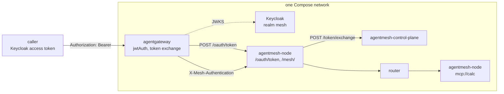

This guide puts [agentgateway](https://agentgateway.dev/) in front of the
mesh, so a gateway that already authenticates your users passes each of them
on with a credential of their own. agentgateway validates the caller's token
from your identity provider, exchanges it at an `agentmesh-node` for a mesh
credential of that caller, and calls the mesh with it. The call never becomes
the gateway's own identity: agentgateway holds no mesh credential, and the
caller's own token does not travel past it.

The whole setup runs on one machine with Docker:
[`development/examples/agentgateway/`](https://github.com/google/agentmesh/tree/main/development/examples/agentgateway)
in the repository has the Compose project, and its `run.sh` runs every step
below and checks each result. It uses Keycloak as the identity provider, as
in [Keycloak as the identity provider](../keycloak/).

## How the pieces fit



agentgateway sends the caller's token to the node's
[token endpoint](../../reference/node-api/#token-endpoint-oauthtoken-and-revocation-oauthrevoke),
which exchanges it at the control plane for a credential bound to that
caller. agentgateway then calls the node's `/mesh/` proxy with that
credential, and the node that publishes the service checks it against the
mesh policy.

## Before you start

You need Docker with Compose v2 and bash (Linux, macOS, or Git Bash on
Windows).

```sh
cd development/examples/agentgateway
./run.sh
```

## 1. Keycloak: access tokens for the mesh

An agent or MCP client sends agentgateway an access token. An access token
from this realm carries no `aud` claim unless a mapper adds one, so the
realm's `agentmesh` client has an audience mapper:

```json
{
  "name": "audience",
  "protocolMapper": "oidc-audience-mapper",
  "config": { "included.client.audience": "agentmesh", "access.token.claim": "true" }
}
```

`alice`'s access token then carries `"aud": "agentmesh"` and
`"groups": ["devs"]`, which is what the control plane checks
(`--allowed-audiences agentmesh`) and what the policy binds
(`calc-user` to `group:devs`).

## 2. agentgateway: validate the caller

The route validates the token before anything else, so a request without a
valid token is refused with `401`:

```yaml
policies:
  jwtAuth:
    mode: strict
    issuer: http://keycloak:8080/realms/mesh
    audiences: [agentmesh]
    jwks:
      url: http://keycloak:8080/realms/mesh/protocol/openid-connect/certs
```

After it validates the token, agentgateway removes it from the request, so no
backend receives it.

## 3. agentgateway: exchange the token at the node

The backend's `oauthTokenExchange` sends the validated token to the node's
`/oauth/token` as an RFC 8693 subject token, and places the credential it gets
back in `X-Mesh-Authentication`, the header the node's `/mesh/` proxy reads:

```yaml
backends:
- host: gateway:8080
  policies:
    backendAuth:
      oauthTokenExchange:
        host: gateway:8080
        path: /oauth/token
        subjectToken:
          tokenType: urn:ietf:params:oauth:token-type:jwt
          source:
            expression: jwt.rawToken.unredacted()
        authorizationLocation:
          header:
            name: x-mesh-authentication
            prefix: "Bearer "
```

- `subjectToken.source` reads the token from the result of `jwtAuth`, because
  `jwtAuth` has already removed it from the `Authorization` header.
- There is no `clientAuth`. The node exchanges a JWT subject token without
  client authentication: the control plane verifies the token's issuer and
  audience, and mints a credential bound to that node that carries the
  caller's identity and roles. agentgateway has no identity of its own in
  it.

## 4. Call a service

```sh
curl -X POST http://agentgateway:3000/mesh/<provider-peer-id>/mcp/calc \
  -H "Authorization: Bearer $ACCESS_TOKEN" \
  -H 'Content-Type: application/json' -H 'Accept: application/json, text/event-stream' \
  -d '{"jsonrpc":"2.0","id":1,"method":"initialize","params":{"protocolVersion":"2025-06-18","capabilities":{},"clientInfo":{"name":"example","version":"0"}}}'
```

| Caller | Result |
|---|---|
| `alice`, group `devs` | `200`, the server's `initialize` response |
| `bob`, group `ops` | `403` from the node that publishes `mcp://calc` |
| No token, or not a token | `401` at agentgateway |
| A token for another client | `401` at agentgateway: it has no `aud` claim |
| A token from another realm | `401` at agentgateway: its signing key is not in the realm's JWKS |

## 5. What a backend receives

The example puts a server that answers with the headers it received behind
the same agentgateway policies. For `alice`'s request it gets:

```json
{"host": "echo", "x-mesh-authentication": "Bearer EsUDCtoCCgpleHBpc...", ...}
```

The exchanged mesh credential is there, and there is no `Authorization`
header: `alice`'s Keycloak token went no further than agentgateway.

## 6. When the caller's token expires

| Moment | Result |
|---|---|
| Before `exp` | `200` |
| Up to 60 seconds after `exp` | `400 invalid request` |
| More than 60 seconds after `exp` | `401` at agentgateway |
| A new token | `200` |

agentgateway accepts a token for 60 seconds after its `exp`: that is the
default leeway of the `jsonwebtoken` library it validates tokens with, and
agentgateway v1.6.0 has no setting for it. The control plane allows none, so
in that minute it refuses the exchange and agentgateway answers `400`. A
client that refreshes its token before `exp` never sees this; one that waits
for a `401` to refresh waits up to a minute longer.

## Where each refusal is logged

| Refusal | Logged by | Line |
|---|---|---|
| A missing, malformed, expired or foreign token | agentgateway | `authentication failure: ...` with `reason=JwtAuth` |
| An exchange the control plane refuses | control plane | `Border Crossing` with `"decision": "deny"` |
| A call the caller's credential does not grant | the node that publishes the service | `[Ingress] AuthZ Denied` with the failed check |

## What to change for a real deployment

- Run Keycloak for production: TLS, a database and a fixed hostname
  ([Configuring Keycloak for production](https://www.keycloak.org/server/configuration-production)).
  Serve the control plane over `https` and drop `--insecure-control-plane`
  from the router and the nodes.
- Put agentgateway and the node it exchanges at on the same trusted host or
  network, and give the token exchange `policies.backendTLS` when the node is
  served over TLS.
- The example gets tokens with the password grant so it runs unattended. Your
  agents and MCP clients get theirs from their own login flow.
- The example's control plane runs with `--auto-approve-enrollment` so the
  router and the two nodes enroll with the bootstrap tokens the script mints.
  Without it, an administrator approves each bootstrap enrollment
  ([Headless enrollment](../headless-enrollment/#3-approve)).

## Cleaning up

```sh
./run.sh down
```

This stops every container and deletes the tokens the script generated
under `.run/`.
