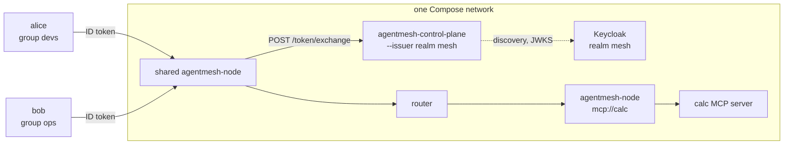

This guide puts the mesh behind an existing [Keycloak](https://www.keycloak.org/)
login. Two users in two Keycloak groups call one MCP service, each with their
own ID token, through one node they share. Membership in a Keycloak group
decides what each may call, the shared node does not lend them its own
permissions, and a token from the wrong client or the wrong realm is refused.
The last step changes a binding and shows when the change reaches each
caller.

The whole setup runs on one machine with Docker:
[`development/examples/keycloak-idp/`](https://github.com/google/agentmesh/tree/main/development/examples/keycloak-idp)
in the repository has the Compose project, and its `run.sh` runs every step
below and checks each result.

## How the pieces fit



The shared node exchanges each caller's ID token at the control plane for a
credential of that caller, and forwards the request with it. The node that
publishes `mcp://calc` checks that credential against the mesh policy before
the request reaches the server.

## Before you start

You need Docker with Compose v2 and bash (Linux, macOS, or Git Bash on
Windows).

```sh
cd development/examples/keycloak-idp
./run.sh
```

The agentmesh images are pinned to the commit the example was tested with;
`AGENTMESH_TAG` selects another published commit or release.

## 1. Keycloak: a realm, a client and a groups claim

`realm-mesh.json` defines the realm `mesh` with:

- the client `agentmesh`, which is the audience the control plane accepts;
- a `groups` mapper with `full.path` set to `false`, so the token carries
  `devs` rather than `/devs`;
- the users `alice` in group `devs` and `bob` in group `ops`.

An ID token for `alice` carries:

```json
{
  "iss": "http://keycloak:8080/realms/mesh",
  "aud": "agentmesh",
  "email": "alice@example.test",
  "email_verified": true,
  "groups": ["devs"]
}
```

A second realm, `elsewhere`, is an issuer the control plane does not trust.

## 2. The control plane trusts the realm

```sh
agentmesh-control-plane \
  --issuer http://keycloak:8080/realms/mesh \
  --allowed-audiences agentmesh
```

The control plane reads the realm's discovery document and keys at start,
and advertises the issuer and the client on `/info` for nodes that enroll.

## 3. The policy binds groups to roles

`policy.json` lets nodes publish, grants them no service, and grants
`mcp://calc` only through `calc-user`:

```json
{
  "roles": [
    { "name": "mesh:role:node", "allowed_targets": ["*"], "allowed_publish": ["mcp://*"] },
    { "name": "calc-user", "allowed_services": ["mcp://calc"], "allowed_targets": ["*"] }
  ],
  "bindings": [
    { "role": "mesh:role:node", "members": ["group:devs"] },
    { "role": "calc-user", "members": ["group:devs"] }
  ]
}
```

`group:devs` matches an entry of the token's `groups` claim. The
[policy reference](../../reference/policy/) lists the other members a
binding can name, such as `email:` and `user:`.

## 4. Enroll a node with a user's token

A node enrolls with an ID token from a file:

```sh
agentmesh-node run --control-plane http://control-plane:8080 --jwt-path alice.jwt
```

| Token | Result |
|---|---|
| `alice`, group `devs` | Enrolled with `mesh:role:node`. |
| `bob`, group `ops` | `403`: `requested role "mesh:role:node" is not bound to this identity` |
| `alice`, for the client `other-app` | `401`: `JWT validation failed: untrusted audience(s): other-app` |
| `alice`, from the realm `elsewhere` | `401`: `JWT validation failed: unknown issuer: http://keycloak:8080/realms/elsewhere` |

`bob` is authenticated, but no binding gives `group:ops` the node role.

## 5. Call a service through a shared node

A caller sends its ID token to a node in `X-Mesh-Authentication`. The URL
names the provider's peer ID and the service; the node appends the path the
service declares in its `target_url`:

```sh
curl -X POST http://gateway:8080/mesh/<provider-peer-id>/mcp/calc \
  -H "X-Mesh-Authentication: Bearer $(cat alice.jwt)" \
  -H 'Content-Type: application/json' -H 'Accept: application/json, text/event-stream' \
  -d '{"jsonrpc":"2.0","id":1,"method":"initialize","params":{"protocolVersion":"2025-06-18","capabilities":{},"clientInfo":{"name":"example","version":"0"}}}'
```

| Caller | Result |
|---|---|
| `alice` | `200`, the server's `initialize` response |
| `bob` | `403` |
| The shared node's own API token | `403` |

`bob` and the node's own token are refused by the provider before the
request reaches the server. The shared node's credential grants no service,
so a caller cannot borrow it.

## 6. Change a binding

`policy-calc-to-ops.json` moves `calc-user` from `group:devs` to
`group:ops`. After it is loaded with `POST /policies`:

| | When it takes effect |
|---|---|
| A grant added (`bob`) | When the nodes take the new policy: at once on the policy update event, otherwise within `--control-plane-sync-interval`. |
| A grant removed, new token (`alice`) | At once: the exchange mints the credential from the current bindings. |
| A grant removed, token already exchanged (`alice`) | When that ID token nears its `exp`. The credential carries the roles it was minted with, and its expiry follows the token's. The node reuses the exchange until 10 seconds before that expiry, then exchanges the token again under the current bindings. |

The ID token lifetime is therefore the longest a removed permission stays
usable by a caller who already holds a token. The example's realms set it to
2 minutes (`accessTokenLifespan`, which the ID token follows) so the script
finishes quickly; Keycloak's default is 5 minutes. See
[Authorization](../../concepts/authorization/) for how grants reach
credentials.

## Where each refusal is logged

| Refusal | Logged by | Line |
|---|---|---|
| Wrong audience or issuer | control plane | `JWT verification failed` with the reason |
| Expired token at the exchange | control plane | `Border Crossing` with `"decision": "deny"` |
| A call the caller's credential does not grant | the node that publishes the service | `[Ingress] AuthZ Denied` with the failed check |

## What to change for a real deployment

- Run Keycloak for production: TLS, a database and a fixed hostname
  ([Configuring Keycloak for production](https://www.keycloak.org/server/configuration-production)).
  Serve the control plane over `https` and drop `--insecure-control-plane`
  from the router and the nodes.
- The example gets tokens with the password grant so it runs unattended. A
  person enrolls a machine with `agentmesh-node join <control-plane-url>`,
  which runs a browser or device login against the client; enable the
  matching flow on the client and turn the password grant off.
- The example's control plane runs with `--auto-approve-enrollment` so the
  router and the two nodes enroll with the bootstrap tokens the script
  mints. Without it, an administrator approves each bootstrap enrollment
  ([Headless enrollment](../headless-enrollment/#3-approve)). User enrollment through
  Keycloak does not depend on it.
- Choose the token lifetime with step 6 in mind: it bounds how long a removed
  grant stays usable by a token already in use.

## Cleaning up

```sh
./run.sh down
```

This stops every container and deletes the tokens the script generated
under `.run/`.
